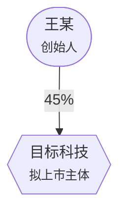

# 结构图生成

> 技术标识：`util-diagram`

**法律关系用文字描述三段还看不明白，一张图两秒就懂。** 尽调报告、交易方案、代理词里的多方关系，图比文字有效得多。

## 四种图

| 类型 | 用于 |
|---|---|
| `equity` | 股权结构——多层持股、代持、一致行动 |
| `deal` | 交易结构——交易前后的股权变化与资金流 |
| `timeline` | 事实时间轴——与「案件事实时间轴」的产出直接对接 |
| `relation` | 法律关系——多方主体间的合同与债权债务 |

## 图形语义（法律含义体现在图形上）

| 图形 | 主体类型 |
|---|---|
| 圆角矩形 | 个人/自然人 |
| 矩形 | 公司 |
| 平行四边形 | 有限合伙（持股平台） |
| 圆角框 | 境外主体/SPV |
| 菱形 | 目标公司 |
| 双线框 | 法院/机构 |

| 线型 | 关系 |
|---|---|
| 实线箭头 | 持股、债权债务等有方向的关系 |
| **虚线箭头** | **代持**——法律上的持股人与实际权利人分离 |
| **无向线** | **一致行动**——不是持股关系，不能用箭头 |

## 适用场景 / 不适用场景

| 情形 | 处置 |
|---|---|
| 尽调报告、交易方案中的结构呈现 | 本 skill |
| 代理词中的多方关系说明 | 本 skill |
| 事实时间轴的可视化 | 本 skill（`--from-timeline` 对接） |
| 正式文书的表格排版 | 「法律文书排版」 |

## 输入要素清单

**必需**：主体清单、主体之间的关系
**建议**：持股比例、关系性质（持股/代持/一致行动/债权）

## 依赖

- 脚本：`scripts/diagram.py`
- 上游：「案件事实时间轴」（timeline 类型直接对接）、「公司治理与股权架构」「尽调发现与法律意见」

## 工作流程

### 第一步：定节点

```bash
--node "王某:个人:创始人" --node "宁波信合投资:有限合伙:员工持股平台"
```

格式 `名称:类型:备注`。类型决定图形，备注显示在第二行。

### 第二步：定边

```bash
--edge "王某|目标科技|45%"            # 实线：持股
--edge "张某|目标科技|20%|dashed"     # 虚线：代持
--edge "王某|李某|一致行动|none"       # 无向：一致行动
```

**线型选错会让图产生误导。** 一致行动画成箭头，看图的人会以为是持股关系。

### 第三步：渲染与嵌入

复制 Mermaid 代码到支持渲染的编辑器；或用 mermaid-cli 导出图片嵌入 Word。

### 第四步：脱敏

⚠️ **对外文书中的结构图同样需要脱敏。** 图里的公司名、人名一样会泄露——转「文件脱敏」。

## 输出模板

```markdown
### 股权结构图



**图例**：实线=持股｜虚线=代持｜无向线=一致行动
**说明**：<图中需要文字补充的要点>
```

## 强制校验项

- [ ] 线型与法律关系性质匹配（代持虚线、一致行动无向）
- [ ] 持股比例标在边上，合计核对无误
- [ ] 节点类型与主体性质匹配
- [ ] 节点数 ≤15，超出已拆分或分层
- [ ] 对外使用的已脱敏
- [ ] 图下有图例与必要的文字说明

## 边界与降级

**图是为了让人两秒看懂，不是展示复杂度。** 节点超过 15 个考虑拆分——一张看不懂的图不如三张看得懂的。

**图不能替代文字。** 图说明结构，法律定性、比例计算依据、特殊安排仍须文字说明。

**Mermaid 渲染依赖环境。** 目标环境不支持时，导出为图片嵌入。

## 示例

**示例一 · 线型的法律含义**
输入：`创始人45%，另外通过持股平台15%，还有20%是找人代持的，跟联合创始人签了一致行动协议。`
→ 持股用实线标比例；代持用**虚线**并注明「代持」；一致行动用**无向线**——三种关系的法律性质完全不同，图上必须区分。

**示例二 · 边界**
输入：`把整个集团 40 家子公司都画进去。`
→ 建议分层：先画核心控制链，再按业务板块分图。**一张 40 个节点的图没有人看得懂。**
